# WillChill｜充值活动分区复用需求文档

**V1.0 · 产品评审稿**　｜　适用端：活动页、运营后台、支付到账与活动结算　｜　示例地区：中东、土耳其

**目标：** 运营开土耳其区时，不需要再做一套活动页、排行榜和发奖流程。用户只能在归属区累计、竞争和获得对应奖励；关掉土区，不改变中东用户的进度、历史榜或待发奖。

**阅读说明：** 第 1 节区分原需求、代码能力和本期改造；第 2–4 节回答“怎么开、谁参加、哪笔算”；第 5–7 节回答“用户看到什么、按什么拿奖”；第 8–9 节用于对账和评审决策。正文中的新规则均为本期设计；带决策编号的条目未批准，不是现网承诺。

## 1. 范围与复用边界

| 模块 | 原需求／原型 | 现有代码可确认 | 本期要解决的问题 |
|---|---|---|---|
| 运营配置 | 一场活动可包含日、周、月档位奖和周、月榜奖；同档可有多件奖品 | 主活动有地区；奖项继承所属活动地区；同区同档允许不同奖品 | 复制规则为新区草稿；预览差异；发布后保留各区当期版本 |
| 充值计分 | WillChill 原型写官方内购、代理充值，充值代理账号不参与排名和奖励 | 支付侧多类交易可上报活动分值；部分上报含赠币，不同交易也可能共用来源 | 识别收币人、原始入账和真实来源；确定归区与有效数量。不以“已经上报”代替“应该计入” |
| 前台与排名 | 同一奖励页切日／周／月；档位最先达标 Top3；另有周／月金额榜、历史榜、规则页 | 已查 H5 充值页是购买套餐入口，不能当作运营活动页已实现 | 同页按登录用户返回本区进度、时间、奖品和榜单，不新增用户选区器 |
| 发奖与查账 | 自动资产与需联系客服的定制权益有不同结果 | 能对已有资格手动单发／批发；按资格的活动、地区、类型、档位查有效奖品。配置支持多种发放方式，并不证明各路径均已上线 | 固定资格归属与奖品版本；逐件记结果；按原区处理补发、客服交付及通知 |

**来源边界。** 页面配图全部取自指定的 Stay《充值活动 PRD 重写版》。它的 EN/AR、UTC+3、币商自充和具体档位属于 Stay。WillChill 原型另有 GMT+4、官方与代理充值、代理账号排除等口径。图用于复用交互结构，**不把图上金额、时间、奖品和英文说明当作中东或土区正式配置**。本期不改首充特惠、支付商品价格、账户地区维护或通用资产系统，不建设通用活动搭建平台。

### 业务主链路

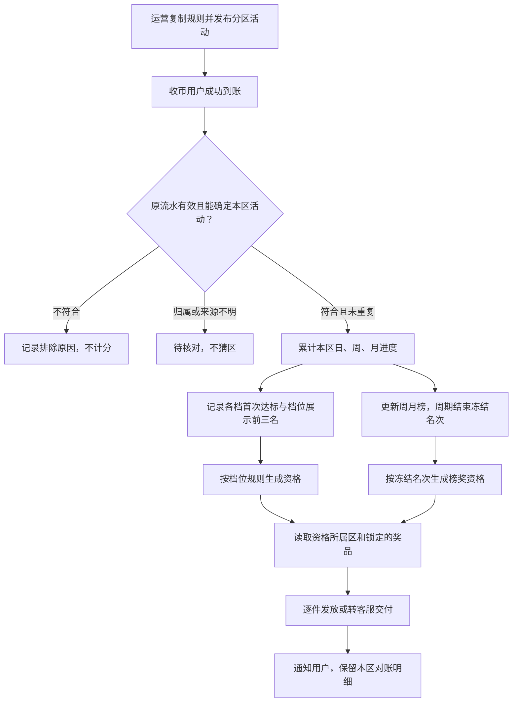

未打开活动页不影响有效到账累计；打开页面也不触发发奖。图中档位资格来自“达档”，不是来自“占据前三名”。

## 2. 运营如何开一个新区

### 2.1 从中东复制到土区，哪些东西会变

| 项目 | 中东活动 | 土耳其草稿 |
|---|---|---|
| 活动身份与状态 | 保留原实例、状态及内部识别码 | 新实例、指定包与土耳其运营区，默认不开放；展示名可改，内部码由系统匹配 |
| 可复用规则 | 页面结构、玩法种类、周期定义、档位／奖品配置格式 | 复制选定版本的规则值作起点；之后修改不回写模板或中东 |
| 必须逐区核准 | 本区时区、有效来源、门槛、榜奖区间、预算、有效物料、客服渠道 | 显示原值与土区拟用值。中东原型时钟 GMT+4；土区可评估伊斯坦布尔时区。两者都以审批后的活动时钟为准 |
| 语言 | 使用本区核准文案 | 配置土语及本区回退语；缺译不回退到中东活动或中东奖池 |
| 不复制 | 用户白名单、进度、Top3、榜单、资格、待发及已发记录、客服待办、操作记录 | 全部为空；测试名单和操作权限另配 |

### 2.2 配置、发布与停用

1. **建草稿：** 运营选包和目标区，再选源模板／版本。日周月的门槛填本区统计单位；周月榜填具体名次或名次段，两者不混用。配置表里的每一行奖品需有物料、数量或天数、交付方式。相同档位可挂多件不同奖品；同一件不得误配两次。
2. **预览：** 同屏核对两区的起止与当地时钟、有效来源、门槛、名次段、奖品、规则文案及客服入口；用目标区样例查看一笔跨档充值和一份含人工权益的奖励。白名单仅在本区生效。
3. **发布：** 检查目标区可识别、同包同区同玩法时间不重叠、门槛递增、名次段不重叠、奖品在目标区可交付、规则与通知有可用语言。复制不等于发布。新编码须能识别五类奖励通知，不能靠活动名称猜模板。
4. **改规则：** 草稿可改；已开期的门槛、榜奖、奖品绑定该期版本，不回改存量资格。单一玩法的新门槛从其下一完整周期生效；影响日周月共同计分的时区、来源、归区政策不在同一实例中途切换，另行排期并说明交接时间。
5. **结束：** 到结束时刻停止接受此后到账；有效期内已到账的记录仍可核对、已获资格继续履约。展示截止与人工权益领取截止分开；若页面先下线，通知中的客服入口仍应可达。提前关区须先决定最后未满周期是否结榜并公告，不能把停入口当作取消旧奖。

**配置表参照。** 原图帮助运营理解“一个名次或门槛对应多件物料”，不是本区已批准奖表。复制、差异预览和分区发布在原稿无对应页面，不能把这张表当作上述操作已经存在。

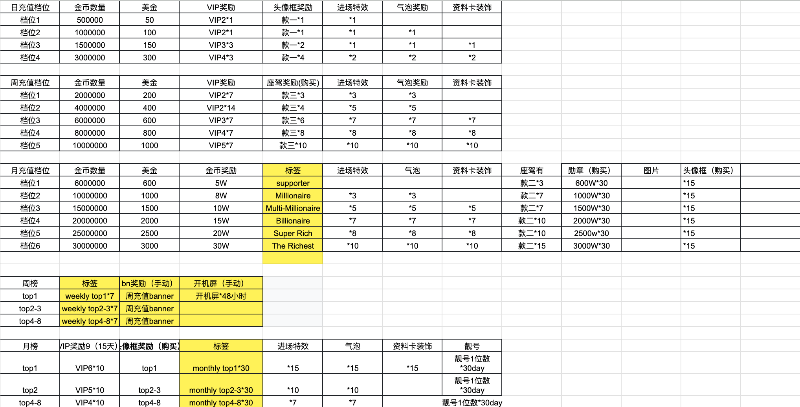

## 3. 谁参加、按哪个区参加

| 情形 | 用户结果与记账规则 |
|---|---|
| 登录用户、本区已开放 | 首页 Banner、房间悬浮窗及分享直达进入同一活动，默认奖励页 Daily。以平台运营大区判定，不以 IP、设备语言、付款国家、币种或链接参数判区 |
| 本区未开放／无法识别地区 | 不展示本区运营入口。直达提示“本区暂无活动”或“暂无法确认活动地区”；不返回其他区榜或奖。无法确定一笔历史充值归属时标待核对，不能永久归默认区 |
| 未登录／无资格账号 | 未登录引导登录，不返回个人进度及名次。代理可为普通用户代充，但按 WillChill 原型，代理本人不参加排名和奖励；风控限制时提供规则或客服入口，不提前承诺到账 |
| 用户改语言／从另一地区分享进入 | 只变文案，不变归属、周期、累计、历史或奖池。返回页面后也不可保留另一账号的数据 |
| 账号申请换运营区 | **D1 提案：活动归属在本场锁定**，已参加用户本场仍在原区，下一场才启用新归属，避免日、周、月交叠造成跨区双奖。若决定立即换区，须另定生效时刻与双区资格上限。两种方案都不得搬迁原流水、改写旧资格或按发奖时的新区换奖品 |

**例：** 土区普通用户通过中东代理买币。若这笔属于土区允许的代理充值，只给土区收币用户加进度；中东代理不加分。若土区未开，中东即使有同名活动也不接这笔账。

## 4. 哪笔充值计入哪一期

### 4.1 计量与来源

以**收币人成功到账**作为判断起点。门槛、进度、Top3 与周月榜统一使用该区批准的有效数量，不按支付发起时间、不按支付货币面额排名。原始入账须能区分本金、附赠部分和活动奖励返币；没有能力区分时不以总到账额替代。

| 来源 | WillChill 本次处理口径 |
|---|---|
| 官方内购；代理给普通用户充值 | 原型列为有效来源。核准匹配方式及赠币口径后计给收币用户，不给代理卖方 |
| 三方链接、提现转金币、钻石兑换、预支／借支、后台线下加币 | Stay 有较宽口径，支付侧也存在多种上报；不直接继承。逐区确认纳入清单并能独立识别前，不计入 |
| 代理本人自充、仅水晶侧变动 | 不按 Stay 的币商自充规则给 WillChill 代理账号排名或奖励；未形成合格用户有效入账的水晶变动不计 |
| 活动奖励返币、红包、补偿、测试／人工调账 | 不计，尤其不能因发奖再触发下一次达档 |
| 失败、重复、退款 | 金币未到账不计；同一笔资产入账多路上报只计一次；退款和撤销关联原流水，按第 8 节处理 |

每笔可解释为：**原始入账 → 谁收到了多少 → 哪部分符合来源规则 → 哪个包、区、活动和周期接纳 → 对应达标及奖励**。一张订单可有多条实际入账；以可核对的唯一入账明细去重，不机械按订单号吞掉合法分笔。金额或归属无法还原时不自动发奖。

### 4.2 活动时钟与边界

日从本区 00:00 起；周从周一 00:00 起；月从每月 1 日 00:00 起。**有效统计窗口 = 本区自然周期与本区活动有效期的交集，含开始、不含结束。** 进度、排名、倒计时、封榜、发奖说明均用同一活动时钟。机身时区不会改变结果。

例如土区周三 15:00 开放：14:59:59 到账不计，15:00 到账可同时进入本区当日、本周、本月；周四 00:00 到账进新日，不清空本周。周日到账、周一收到补单时，按原到账时间归原周：未冻结时补算；已冻结时留差异待审，不把上一周的分加到本周。活动结束时刻到账不计；活动结束前已达标的最后一批不因次日才发奖而作废。

## 5. 用户活动页：同一套页面，只读本区

### 5.1 Daily：我今天还差多少

默认展示用户 ID、本区日累计、下一档门槛、剩余差额、奖励卡及所选档的最先达标者。差额为下一档门槛减累计，最低为零；达到最高档显示“本期已达最高档”。顶部人物位读取**本区当月充值榜第一名**，不跟随日周月标签切换；无人上榜用占位，不借用其他区用户。

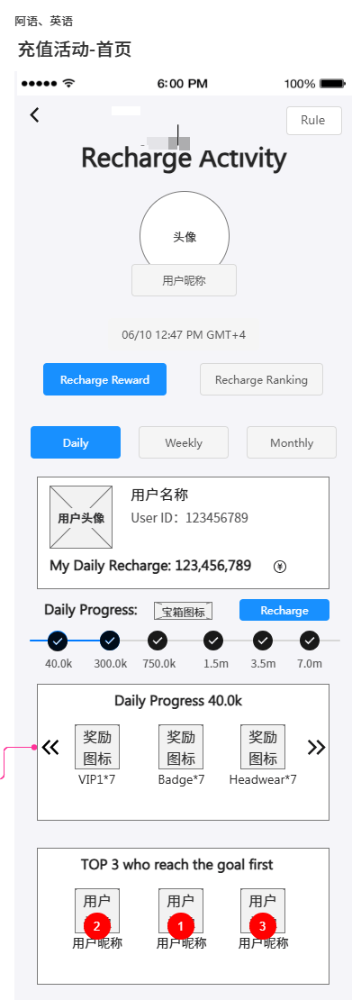

点击 Recharge 只跳转充值，不预加分；返回后刷新实际到账进度。点击节点预览对应档位，不等于领取。下图在旧稿中名为 Daily Top3，实际展示的是**个人日累计与进度节点**。

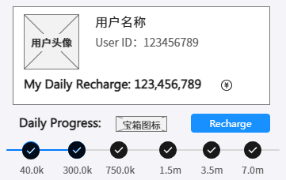

### 5.2 Weekly：本周进度不随换日清零

切 Weekly 后整体替换为本区本周累计、周门槛、周奖卡和本周本档 Top3。切换请求未完成时显示加载态；失败时不把 Daily 数据贴在 Weekly 标题下。即使周榜尚未刷新，本人进度也应在充值返回时单独刷新。

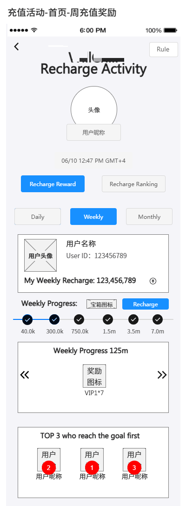

### 5.3 Monthly：自然月不是最近三十天

切 Monthly 后展示本区自然月累计及月档权益。月底进入新月时新进度从零开始，旧月已达标但尚未交付的权益仍可由通知／客服查到。

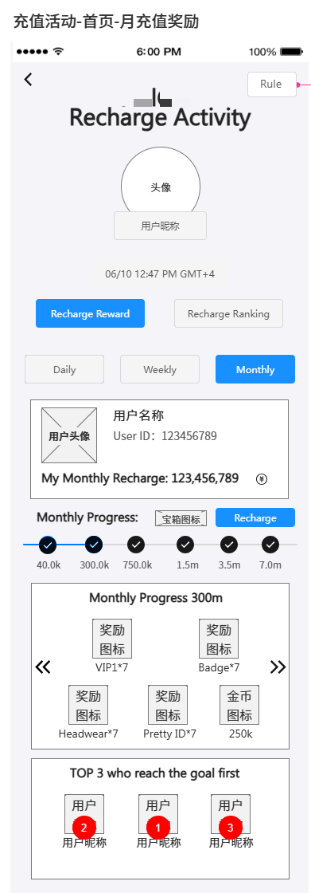

### 5.4 档位、奖品与金额的关系

按**本区、本期配置表**生成节点，不从首页截图读金额。每档展示全部奖品、数量／有效天数、到账或人工交付方式。当前累计达到门槛即记录首次达标；“已达标”不等于“已到账”。同一笔可同时贡献三个周期的进度，但计入多个周期**不直接等于**可领取全部奖励，发奖模式见 D4。

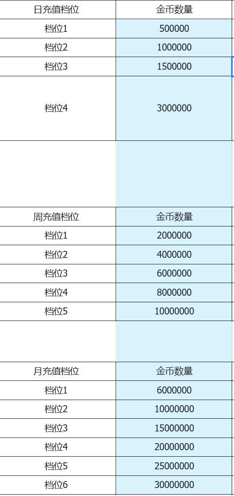

**日档：** 左右切换对比不同档的奖品；只切卡片，不变个人累计。原图 05 为纯白切图，不作为低档详情依据，图 06 中可见日档奖卡结构。

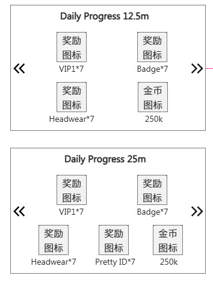

**周档：** 周累计、选中门槛及奖励卡必须同属一版周配置，不能因今天上新日档而改写本周奖品。

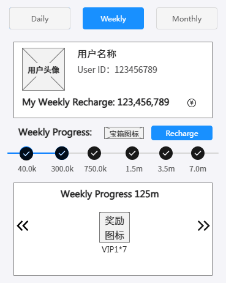

**月档：** 自动资产与客服定制品可同卡预览，但显示各自的交付方式；用户据此判断“还要不要联系客服”。

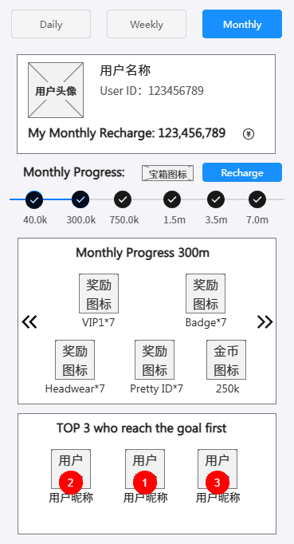

### 5.5 档位最先达标 Top3：比谁先到，不比谁充得多

日、周、月分别按**本区＋本期＋当前查看的档位**取最先达到门槛的三个不同用户。首次达标用有效到账时刻，不用处理时间；同一人同档只占一位，可在更高档再次出现。不足三人留空位。**这里只展示荣誉，除非单独核准，不产生第六类奖励。** 日态见图 01 底部；下图为周态组件。

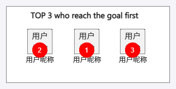

月态沿用布局，但读取月数据，不沿用周名单。两人同一毫秒达档及退款后递补的排序口径见第 6 节。

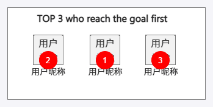

### 5.6 Rule：用户看到的就是本区执行的规则

从当前页进入，返回保留原标签。说明本区名称与活动时钟、哪些来源／身份计入、是否含赠币、跨档与跨周期奖励、发奖时刻、联系客服的入口和期限、异常交易处理。引用本区已发布版本；缺少本语言时只回退至**同区同版本**的核准文案。拿不到对应规则时提示重试，不展示另一区的承诺。

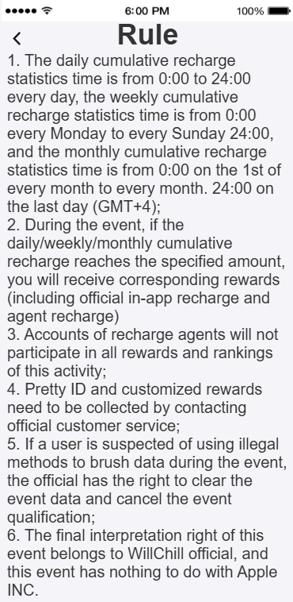

## 6. 周月充值榜与历史榜

### 6.1 当前榜：决定谁排第几

默认周榜，可切月榜；没有日金额榜。按本区、本期展示倒计时、名次奖品预览、Top20 和置底个人条（沿用 Stay 展示方案，D6）。有有效累计但排在展示范围外显示“20+”及本人成绩；无有效累计显示“未上榜”，不与第 21 名混淆。进度更新与公开榜刷新可不同步，榜单展示更新时间；倒计时归零以服务端时间为准，旧期转“结算中”，不得清空旧记录。

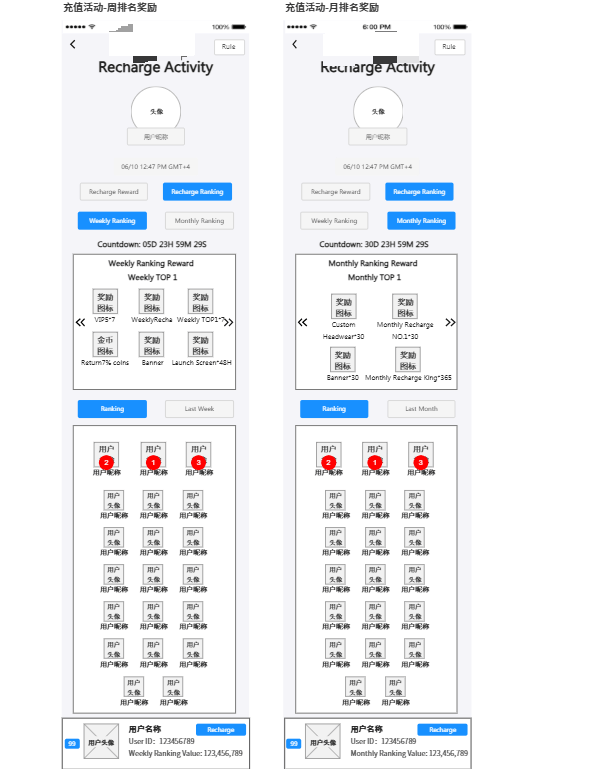

| 对象 | 推荐排序，待 D6 确认 | 使用场景 |
|---|---|---|
| 档位 Top3 | 首次有效达标时间升序，再按固定用户 ID 升序 | 同一套排序用于奖励页和未冻结周期纠错；退款使达标无效时，按有效流水重演后递补 |
| 周／月金额榜 | 有效累计降序 → 首次达到该最终有效累计的时间升序 → 固定用户 ID 升序 | 本区 Top20、我的排名、月第一、封榜与榜奖共用；不混用财富等级或各页面自行打破平局 |

### 6.2 历史榜：说明当时为什么获奖

按本区和周期结束时间倒序，只读已冻结名次、金额和当时用户展示信息。沿用底稿的展示候选：最近三周／三月默认前三，可展开至奖励覆盖名次；不足三期显示实际期数。无历史显示空态；冻结失败显示“结算中”，不从实时榜伪造历史。获奖名单冻结后，奖励交付状态仍可更新。换区后不能浏览其他区公开榜，客服仍可按本人旧资格解释旧奖。

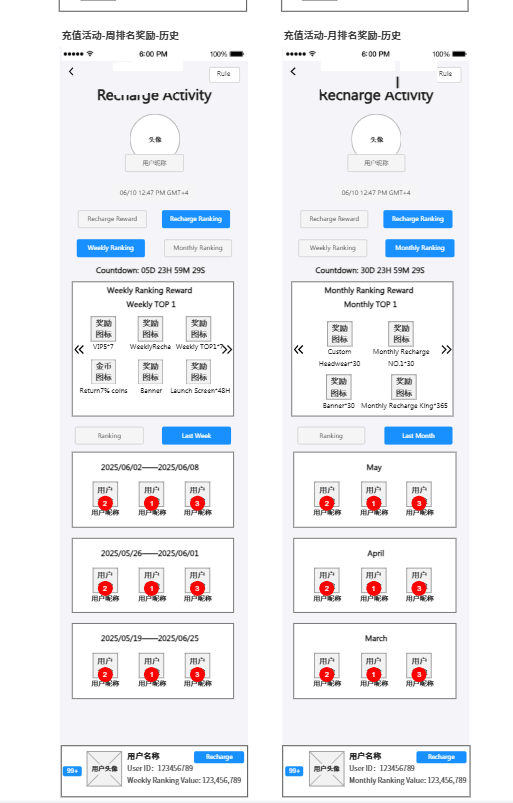

**榜奖人数独立于展示人数。** 底稿中的第 1、第 2–3、第 4–8 名是候选奖组，不是固定给两区各发八份。目标区只给实际符合资格、落在已批准奖组的名次发奖；若后台按单个名次存储，发布预览应列出展开后的每一名，不能把“4–8”误读成充值门槛。

## 7. 从资格到实际拿到奖励

| 环节 | 本期需求 |
|---|---|
| 生成资格 | 档位按本区当期跨档模式；榜奖按冻结快照。资格固定活动、区、用户、周期、档位或名次、规则版本和逐件奖品。生成后不因用户换区、改模板、停入口而重取新奖品 |
| 等待处理 | 展示本区明确的计划处理时间。Stay 的档奖次日 00:00、榜奖封榜后当地 01:00 只是排期候选（D5）。新日、周、月同时开始时，要处理上一期最后一批，不能只查“本周／本月” |
| 交付资产 | 按奖品发放方式派发。VIP、装扮须有有效天数；货币须先确认实际账户类型。仅收到资产成功凭证才标已到账；超时先查是否已入账，再决定重试 |
| 交付定制品 | 靓号、定制权益生成客服／运营待办，显示所属区入口和截止时间。客服核对原资格后登记交付结果；已核销或已过期不可再次核销。此流程不同于用户自己点按钮领取资产 |
| 部分成功与通知 | 一档含两件奖品时可显示“头像框已到账，靓号待联系客服”。发奖失败展示处理中；后台只补未成功的那一件。通知按日／周／月档、周／月榜区分，榜奖带原名次；通知失败只补消息，不补资产 |

防重分三层：同一入账只加一次；同一活动实例、区、用户、周期、奖励来源与档位／名次只产生一份应发资格；该资格下同一奖品项只成功交付一次。批量发放逐条返回成功／失败／待查，不能因为第二人失败再发第一人的奖。活动级与奖励级发放方式不一致时，运营须在发布前看到并确认最终逐项方式；未确认的冲突不能进入批次。

## 8. 运营查账、纠错与资产操作

### 8.1 客服如何回答“为什么我没拿到”

按包、区、玩法、日期和用户 ID 查询，日查单日、周查最多七天、月查单月。**查询区间不是计奖周期**：运营查周三至周五，不会生成一个三天的周奖。列表看本区累计、达成档、名次、应发及实发；详情沿原始到账、接收人、当时归区、来源、本金／赠币、有效数量、周期版本、资格、逐件回执或人工处理人追溯。导出沿用相同筛选和地区权限。客服只能查被授权区域、处理已授权的人工权益，不得直接改充值累计；跨区汇总只作统计，不据此发奖。

### 8.2 后台赠送：加币成功不等于活动充值

底稿用“金币＋线下充值原因”识别线下入账。**本期只复用操作位置，不默认开放新来源。** 目标区明确接纳且能核对原始收款与实际入账时，才按一次有效入账处理。其他赠送原因、奖励补发、测试或补偿均不得触发活动；仅备注写“线下充值”无效。

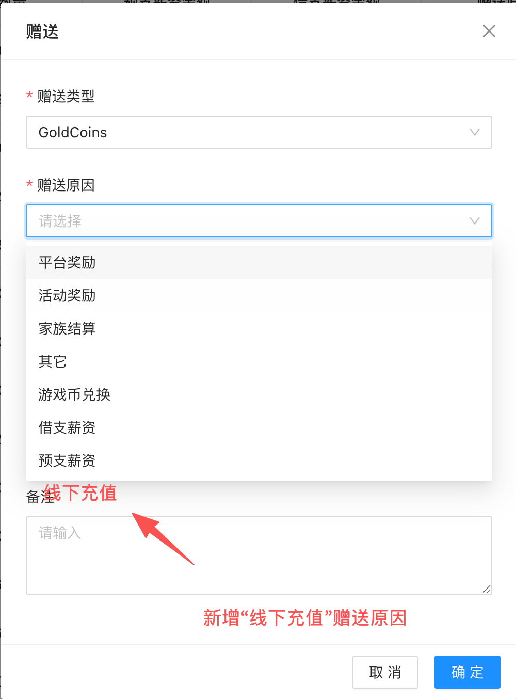

### 8.3 后台扣除与退款：只影响原区，不能重复扣

退款按原有效入账冲正；一般资产扣除不联动活动。底稿的“充值活动扣除”作为独立候选能力（D7），**不得直接按用户此刻所在区找钱扣**。启用前须能预览原区、原流水、可冲金额、涉及周期、名次及已发奖。部分退款仅扣已确认的有效部分：若原有效 100、冲正 30，净有效仍为 70；同一冲正重放不会再扣 30。累计最低为零，不能从其他地区或另一笔无关入账凑数。

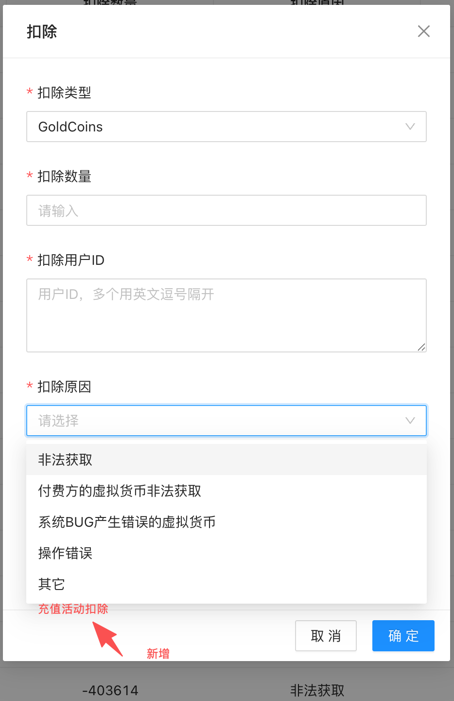

未冻结期重新计算受影响的档位、Top3 和周月榜；仍满足的低档保留，不再满足且未发的资格撤销。已发资产或已交付权益进入风控审核，记录追回／保留结果，不自动扣成负余额。已冻结期保留原榜，另记差额、审批和补偿结果。资产扣除与活动计分冲正分开记账；同一退款或人工处理已有冲正时，禁止二次扣分。

## 9. 评审决策与上线顺序

| 编号 | 必须确定的事项 | 可供拍板的口径／影响 | 确认方 |
|---|---|---|---|
| D1 | 权威运营区、归属生效点、换区 | 推荐本场归属锁定；避免同时冲两个区。若允许即时迁区，写明同周期多区获奖限制及老资格查询入口 | 产品＋用户域 |
| D2 | 两区时钟、首末窗口、提前终止 | 按本区时钟取活动与自然周期交集；中东不凭 Stay 定为 UTC+3，土区不凭国家代码设时钟。部分周期是否按截单发榜奖须预先公布 | 地区运营＋产品 |
| D3 | 有效来源、受益身份、赠币 | 核准逐区白名单；建议以可归因的充值本金金币为基数。若含赠币须区分套餐赠币与活动返币；用支付明细证明可区分 | 支付＋活动＋运营 |
| D4 | 跨档、跨周期、跨奖励来源成本 | 候选为逐档发、日周月可叠加、新日可重新达档、档奖与榜奖可兼得；非生产规则。若只发最高档则应按周期结束确定，不可先发低档再无规则补高档 | 产品＋运营／预算 |
| D5 | 奖品明细、实际币种、发放窗口和期限 | 核准每区物料与数量、日周月处理时点、迟到流水处理期限、人工权益截止日。区分后台人工发、用户领取、客服交付；未实现的方式不对用户展示 | 资产＋活动＋客服 |
| D6 | 并列排序、榜奖名额和历史范围 | 两类榜分别按第 6 节方案确认；冻结后不改原名次。确定本区 Top20／奖组／历史可展开范围与刷新频率 | 产品＋地区运营 |
| D7 | 线下充值、人工扣分和追回 | 可先不开人工资产联动；如启用，须确认原流水匹配、操作权限、复核与资产追回边界 | 财务／风控＋运营 |

**实施顺序。** 先由用户域与活动服务核实归区、入账去重、来源过滤、资格生成和结算位置；不能从配置页有“地区”推断全链路已隔离。中东先用同一批脱敏流水只算不发，逐笔比累计、首次达标顺序、最终名次和逐件奖品；差异未解释不切换。切换给旧、新发奖流程划定唯一负责的实例和周期，未发旧奖留在旧流程。土区再按本区测试名单灰度，检查跨区代付、零点补单、部分发奖失败、单区停用；出现串区或重复到账即停止新流程，保留记录供对账。**可进入产品／研发评审；D1–D6 未确认前不冻结结算规则，D7 未确认不启用人工联动。**

**材料核对。** Stay 原稿引用 17 份图：本稿按页面功能使用其中 16 份；图 05 是纯白图，未作为功能依据。图 07 按实际画面用于日进度。模板复制、分区发布预览、逐件履约和冲正预览没有对应原型，不以其他页面冒充。实现依据限于此前核对的管理前端、管理服务、支付服务与充值 H5；未核实生产配置、实际资产到账及下游活动服务全链路。
